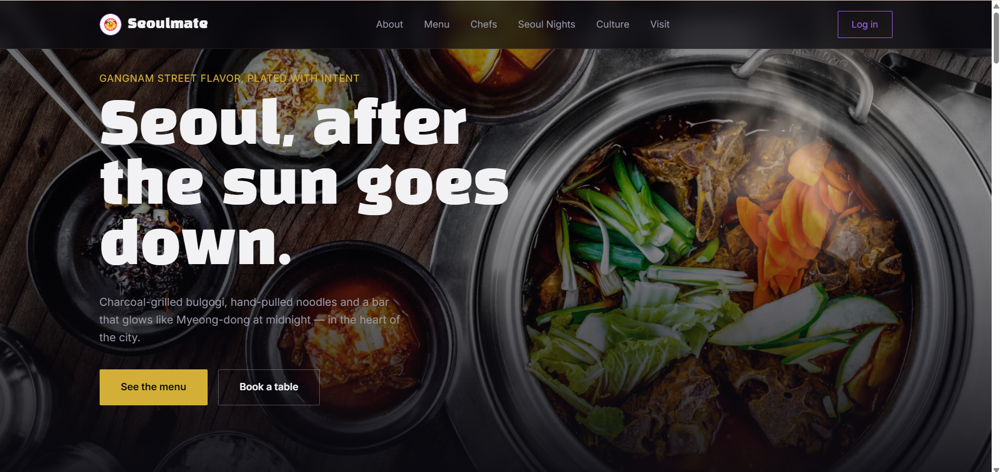
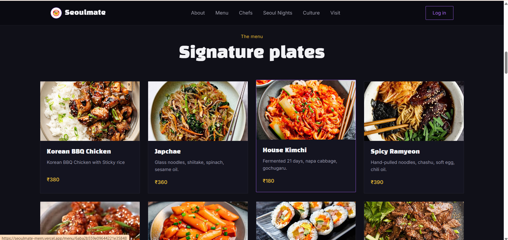
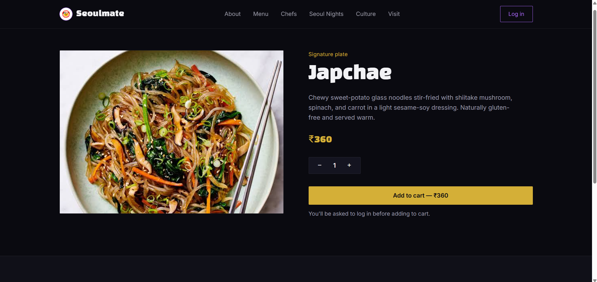
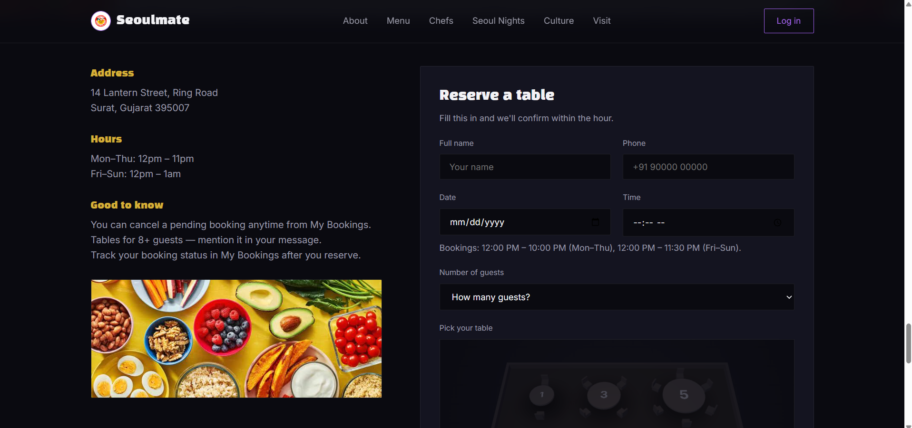
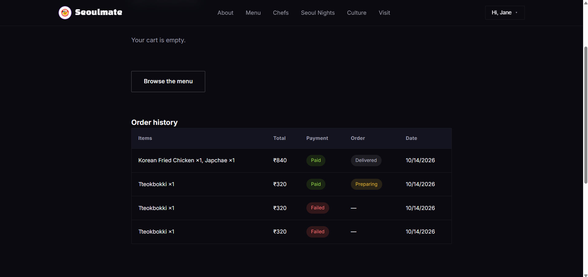
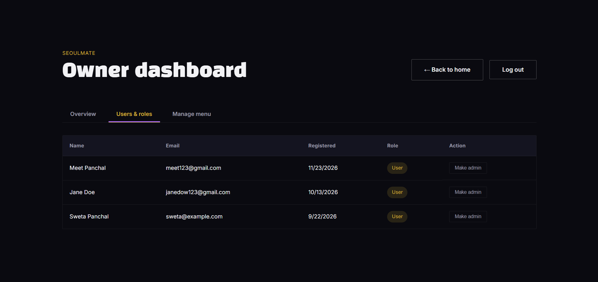

# Seoulmate 🍜

Modern Korean restaurant ka full-stack MERN web app. Customer menu dekh sakta hai, online payment karke order de sakta hai, aur 3D floor plan se apni pasand ki table reserve kar sakta hai. Staff ke liye alag dashboards hain.

**Live demo:** https://seoulmate-mern.vercel.app

> Backend free tier par hai, isliye pehli baar kholne par 30-50 second lag sakte hain.

## Problem

Chhote restaurants me table booking aksar phone par hoti hai. Customer ko pata nahi hota ki kaunsi table khali hai, aur staff ke paas bookings aur orders ka ek jagah record nahi hota, jisse double-booking aur confusion hoti hai. Seoulmate ye sab ek jagah laata hai: customer live dekhta hai ki kaunsi table available hai, aur staff ek dashboard se bookings aur orders sambhalta hai.

## Screenshots

| Home | Menu |
|---|---|
|  |  |

| Dish Detail | Table Reservation |
|---|---|
|  |  |

| Orders | Owner Dashboard |
|---|---|
|  |  |

## Features

### Customer

- Menu database se aata hai, har dish ka alag detail page hai
- Cart (har user ka alag), Razorpay se online payment (test mode)
- Order history me payment aur order status dikhta hai
- Table reservation: 3D floor plan (Three.js), date/time ke hisab se available tables, guests ki sankhya
- My Bookings page: booking ka status dekho aur pending booking cancel karo

### Staff (Admin / Owner)

- Admin dashboard: reservations confirm/cancel, users, orders ka status update, menu manage
- Owner dashboard: overview stats, users ke roles badalna (Make admin / user), menu manage

### Common

- Email/password aur Google login
- Role-based access (User, Admin, Owner)
- Auth routes par rate limiting, Helmet security headers

## Tech Stack

| Layer | Tech |
|---|---|
| Frontend | React 18 (Vite), React Router, Three.js, Google OAuth |
| Backend | Node.js, Express 5 |
| Database | MongoDB Atlas, Mongoose |
| Auth | JWT, bcrypt, Google OAuth |
| Payments | Razorpay (test mode) |
| Email / Uploads | Nodemailer, Multer |
| Security | Helmet, express-rate-limit |
| Hosting | Vercel (frontend), Render (backend) |

## Kuch Technical Highlights

- **Server-side price:** Order ka amount hamesha database ke menu se server nikalta hai, client ka bheja hua price kabhi nahi maana jata.
- **Payment verification:** Razorpay ka payment signature server par verify hone ke baad hi order "paid" hota hai.
- **Double-booking se bachav:** Har date + table ke liye lock lagta hai, aur 2 ghante ke slot ka overlap check hota hai, to ek hi table do logon ko nahi milti.
- **Booking rules server par:** Opening hours, past time ka block (India time ke hisab se), aur guests ka table ki seats me fit hona, ye sab server verify karta hai.
- **Role database se:** Har request par role token se nahi, database se padha jata hai, isliye kisi ko demote karte hi access turant band ho jata hai.
- **Owner login:** Owner ke credentials `.env` se aate hain (database me nahi), aur password timing-safe tareeke se compare hota hai.
- **Lazy loading:** Three.js ka code alag chunk me hai aur zaroorat par hi load hota hai, to pehla page tez khulta hai.

## Folder Structure

```
SeoulmateMERN/
├── client/          # React frontend
│   └── src/
│       ├── components/   # UI components (Hero, Menu, Contact, Footer...)
│       ├── pages/        # Home, DishDetail, Orders, MyBookings, dashboards
│       ├── context/      # Auth aur Cart context
│       └── config/       # siteInfo (contact details)
├── server/          # Express backend
│   ├── controllers/
│   ├── models/
│   ├── routes/
│   ├── middleware/
│   ├── utils/
│   ├── data/        # table layout
│   └── seed.js      # starter menu
└── screenshots/
```

## Local Setup

Requirements: Node.js 18+, MongoDB Atlas account, Google OAuth Client ID (optional), Razorpay test keys (optional)

```bash
git clone https://github.com/swetapanchal-244/Seoulmate_MERN.git
cd Seoulmate_MERN
```

**Server**

```bash
cd server
npm install
```

`server/.env.example` ko copy karke `server/.env` banao aur ye values bharo:

```
PORT=5000
MONGO_URI=your_mongodb_connection_string
JWT_SECRET=your_long_random_secret
GOOGLE_CLIENT_ID=your_google_client_id
OWNER_EMAIL=owner_email
OWNER_PASSWORD=owner_password
RAZORPAY_KEY_ID=your_razorpay_test_key_id
RAZORPAY_KEY_SECRET=your_razorpay_test_key_secret
EMAIL_USER=your_gmail
EMAIL_PASS=your_gmail_app_password
CLIENT_URL=http://localhost:5173
SERVER_URL=http://localhost:5000
```

Long random `JWT_SECRET` banane ke liye:

```bash
node -e "console.log(require('crypto').randomBytes(64).toString('hex'))"
```

Starter menu daalne ke liye (sirf khali database par, ye pehle Dish collection ko saaf karta hai):

```bash
node seed.js
```

```bash
npm run dev
```

**Client**

```bash
cd client
npm install
```

`client/.env.example` ko copy karke `client/.env` banao:

```
VITE_API_URL=http://localhost:5000
VITE_GOOGLE_CLIENT_ID=your_google_client_id
```

```bash
npm run dev
```

**Roles kaise bante hain**

| Role | Kaise milta hai |
|---|---|
| User | Normal signup ya Google login |
| Admin | Owner dashboard se kisi user ko "Make admin" karke |
| Owner | `server/.env` ke `OWNER_EMAIL` aur `OWNER_PASSWORD` se, login `/owner` par |

## API Overview

| Method | Endpoint | Access |
|---|---|---|
| POST | `/api/auth/register`, `/login`, `/google` | Public |
| POST | `/api/auth/owner-login` | Public (owner credentials) |
| GET | `/api/auth/users` | Staff |
| PATCH | `/api/auth/users/:id/role` | Owner |
| GET | `/api/menu`, `/api/menu/:id` | Public |
| GET / POST / PUT / DELETE | `/api/menu/admin-all`, `/api/menu`, `/api/menu/:id` | Staff |
| POST | `/api/menu/upload` | Staff |
| GET | `/api/tables?date=&time=` | Public |
| POST | `/api/reservations` | Logged in |
| GET | `/api/reservations/my` | Logged in |
| PATCH | `/api/reservations/my/:id/cancel` | Logged in |
| GET / PATCH | `/api/reservations`, `/api/reservations/:id` | Staff |
| POST | `/api/payment/create-order`, `/verify`, `/failed` | Logged in |
| GET | `/api/orders/my` | Logged in |
| GET / PATCH | `/api/orders`, `/api/orders/:id/status` | Staff |

## Live Demo Ke Baare Me

- Payments Razorpay **test mode** me hain, asli paisa nahi katta.
- Google login abhi sirf approved test users ke liye hai. Email/password se koi bhi register kar sakta hai.
- Free Render plan par outbound SMTP block hota hai, isliye order confirmation email live par nahi jati. Order aur payment phir bhi sahi chalte hain.
- Menu Manager se upload ki gayi images server ki disk par rehti hain, jo free hosting par permanent nahi hoti.

## Future Improvements

- Image storage ko cloud (Cloudinary) par shift karna
- Razorpay webhook aur forgot password (email reset)
- Booking confirm/cancel par email notification, confirmed booking ko user ka cancel karna
- Dishes ke real reviews aur ratings
- Order type (dine-in / takeaway), menu category filter aur admin analytics

## Author

Sweta Panchal
GitHub: [@swetapanchal-244](https://github.com/swetapanchal-244)